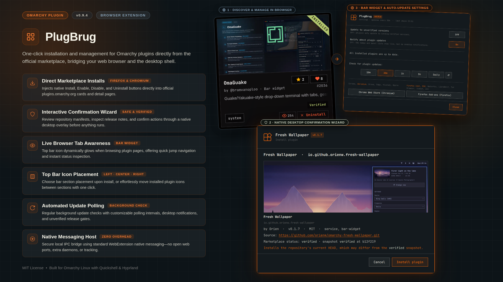

# Omarchy Browser Plugin Manager

One-click plugin installs from [plugins.omarchy.org](https://plugins.omarchy.org).

> **Note:** The Firefox and Chromium browser extensions are currently under
> review and will be available soon from their respective official sources
> (Firefox Add-ons and the Chrome Web Store). Until then, both extensions can
> be downloaded from the assets section of the
> [latest release](https://github.com/bramvanoploo/omarchy-browser-plugin-manager/releases/latest)
> and installed manually — see [INSTALL.md](INSTALL.md).



Clicking **Install** on a plugin page opens a wizard overlay on the desktop:
it re-validates the request (live catalog entry + repository manifest), shows
what will be installed, and for bar widgets first asks which bar section the
icon goes in (left, center, right; the manifest's default is labelled
"(default)" — nothing is installed before that choice, so Cancel is a plain
close). It installs only after you confirm, via the official
`omarchy plugin add` + `omarchy plugin enable --section` (clone + manifest
validation, no code execution), then verifies the result (enabled flag + bar
layout entry), re-applying the section if the shell's post-install config
sweep reverts it.

Once a plugin is installed, the page swaps Install for **Enable/Disable** and
**Uninstall** buttons (state read live from the host, never from the page).
Every action ends in a desktop notification — no completion dialog. On the
catalog page, each card gains an icon-only Install/Uninstall button beside
its "Copy install command" button; "Manual" badges are never touched.

**Bar-icon watcher mode**: while a plugin page is the active tab of a
*focused* browser window, the extension renews a beacon with the local host
every 5s and the Omarchy bar icon lights up (accent tone); switching to
another plugin tab sends "unwatch" (id-scoped) and the icon and panel follow
right away, while switching to another application stamps the record
"paused" so the placeholder returns on the widget's next poll (≤2s);
focusing the browser again lights the icon immediately. Pages for plugins
that are *not* installable from the browser (no install command, built-in,
failed upstream check) light the icon too when the plugin is installed on
this machine, so its panel (update/uninstall/move icon) is reachable; no
page buttons appear there. Left click opens a dropdown with that plugin’s
header title (as in the dialogs) and buttons to **Install**, **Update**,
**Uninstall**, and move its bar icon (left/center/right). Install, Update,
and Uninstall summon the same wizard — the beacon is a display hint, the
wizard re-validates and asks for confirmation; moving the icon is plain
layout config, so it runs `omarchy bar move` directly.

Right click opens the settings panel (same header style): a plugin-update
poll every **10m / 30m / 1h / 5h / Daily** with a refresh button to check
immediately, an **Update N plugins now** button (shown only while updates
are available), a toggle to also update plugins to their *unverified*
latest versions (default: latest verified only), and links to the Chrome
Web Store and Firefox Add-ons pages: the supported browsers are listed with
the installed ones highlighted, and each button names the browser it opens
the page in (the first installed browser of that family). The poll compares
every installed user plugin's version against the marketplace catalog;
while plugins have
updates, the bar icon shows a counter in its top-right corner (accent when
the updates are updatable, muted when held back by the verified-only
setting; hidden at 0), and a poll that finds new updates sends a
notification offering them. Settings persist to `settings.json` in the
plugin's state directory.

## Architecture

See [documentation/ARCHITECTURE.md](documentation/ARCHITECTURE.md) for the
component overview: extension, native messaging host, setup script, wizard
overlay, and bar watcher.

## Browser extensions

| Browser | Extension |
| --- | --- |
| Firefox-based (Firefox incl. ESR, Waterfox, LibreWolf, Tor Browser, GNU IceCat, Zen) | [Firefox Add-on](https://addons.mozilla.org/nl/firefox/addon/omarchy-browser-plugin-manager/) |
| Chromium-based (Chrome, Chromium, Brave, Edge, Vivaldi, Opera) | [Chrome Web Store](https://chromewebstore.google.com/detail/nalcgjmbglkcmohokidcmogcbpmhkdjf) |

Prefer not to use the stores? Every [GitHub release](https://github.com/bramvanoploo/omarchy-browser-plugin-manager/releases/latest) ships the extension packages for direct download — the AMO-signed Firefox `.xpi`, the Chrome-family build, and the full source archive; see [INSTALL.md](INSTALL.md).

The Omarchy plugin registers the native messaging host itself (every shell
start, idempotently); the browser extension alone is not enough.

After installing this plugin in Omarchy, the wizard shows a one-time prompt
(install only, not on later enables): it detects the default browser
(`xdg-settings get default-web-browser`, falling back to the
`x-scheme-handler/https` association), opens the matching extension page
from the table above, and links the other family's page. Cancelling shows a
warning that the plugin is inert without its browser extension, with buttons
to open the extension page, cancel, or uninstall the Omarchy plugin.

## Installation

1. Add the Omarchy shell plugin (wizard + native messaging host):

```bash
omarchy plugin add https://github.com/bramvanoploo/omarchy-browser-plugin-manager --enable
```

2. Install the browser extension from the table above — the wizard's
   one-time prompt right after step 1 links the right page. No manual host
   setup is needed. For installing without the browser stores, see
   [INSTALL.md](INSTALL.md).

## Uninstall

The wizard path (the browser's Uninstall button, or "Uninstall Omarchy
plugin" in the extension prompt) unregisters the native messaging host and
removes the plugin in one confirmed action.

Terminal removal works too:

```bash
omarchy plugin remove bramvanoploo.omarchy-browser-plugin-manager
```

Removing the plugin unloads the wizard, whose detached self-cleanup
unregisters the host a few seconds later (best effort: it needs the shell
running at removal time). If the manifests survive anyway, run
`~/.config/omarchy/plugins/bramvanoploo.omarchy-browser-plugin-manager/bin/plugin-installer-setup --uninstall`
before removing — the script lives inside the plugin folder. Then remove the
browser extension (chrome://extensions / about:addons).

## Security model

See [documentation/SECURITY.md](documentation/SECURITY.md) for the layered
validation: extension scoping, native host manifest origin pinning, fresh
catalog re-validation, and the wizard's consent gate.

## Roadmap

See [documentation/ROADMAP.md](documentation/ROADMAP.md) for what is planned
and already shipped.
