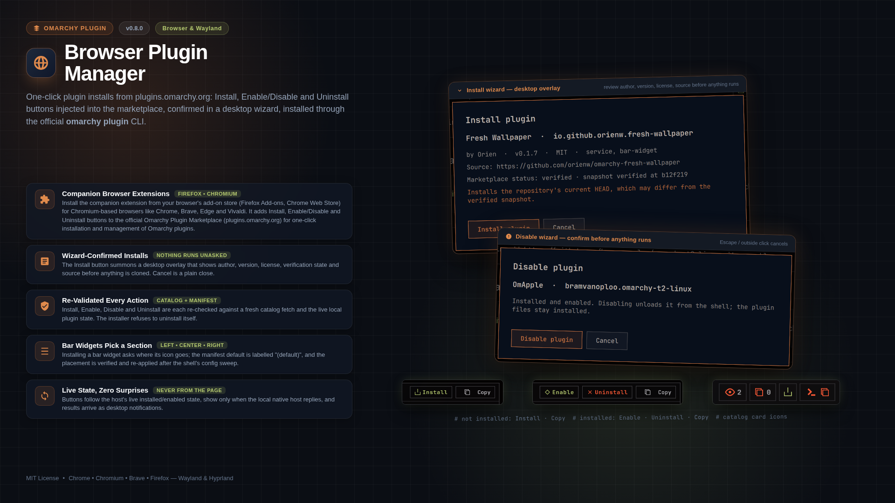

# Omarchy Browser Plugin Manager

One-click plugin installs from [plugins.omarchy.org](https://plugins.omarchy.org).



Clicking **Install** on a plugin page opens a wizard overlay on the desktop:
it re-validates the request (live catalog entry + repository manifest), shows
what will be installed, and for bar widgets first asks which bar section the
icon goes in (left, center, right; the manifest's default is labelled
"(default)" — nothing is installed before that choice, so Cancel is a plain
close). It installs only after you confirm, via the official
`omarchy plugin add` + `omarchy plugin enable --section` (clone + manifest
validation, no code execution), then verifies the result (enabled flag + bar
layout entry), re-applying the section if the shell's post-install config
sweep reverts it.

Once a plugin is installed, the page swaps Install for **Enable/Disable** and
**Uninstall** buttons (state read live from the host, never from the page).
Every action ends in a desktop notification — no completion dialog. On the
catalog page, each card gains an icon-only Install/Uninstall button beside
its "Copy install command" button; "Manual" badges are never touched.

**Bar-icon watcher mode**: while a plugin page is the active tab of a
*focused* browser window, the extension renews a beacon with the local host
every 5s and the Omarchy bar icon lights up (accent tone); switching to
another plugin tab sends "unwatch" (id-scoped) and the icon and panel follow
right away, while switching to another application pauses the beacon so the
record expires (≤12s) and the placeholder returns. Pages for plugins that
are *not* installable from the browser (no install command, built-in, failed
upstream check) light the icon too when the plugin is installed on this
machine, so its panel (update/uninstall/move icon) is reachable; no page
buttons appear there. Left click opens a dropdown with that plugin’s
header title (as in the dialogs) and buttons to **Install**, **Update**,
**Uninstall**, and move its bar icon (left/center/right). Install, Update,
and Uninstall summon the same wizard — the beacon is a display hint, the
wizard re-validates and asks for confirmation; moving the icon is plain
layout config, so it runs `omarchy bar move` directly.

## Architecture

```
browser (extension)  ->  native messaging host  ->  shell IPC  ->  wizard overlay
                          validates vs catalog.json     omarchy plugin add/enable/
                          never installs                disable/remove/update;
                          watch beacon  ---------------->  bar widget (watcher)
                                                        confirm first, notify when done
```

- **`extension/`** — MV3 WebExtension for Chrome, Chromium, Brave
  (Firefox-compatible MV3; the source manifest carries no Chrome-only
  `"key"` — Firefox flags it and the CWS dashboard rejects it). Buttons are
  injected on `plugin.html?id=...` (button groups) and the catalog
  `index.html` (icon-only button) only when the marketplace's own rule
  passes (`installAvailable && upstreamCheckStatus !== "failed" &&
  installCommand`) **and** a ping to the local host succeeds; the button set
  then follows the host's live `status` report (`omarchy plugin list
  --json`). Manual-setup pages and machines without this plugin show no
  buttons — the site renders untouched.
  While the plugin page is the visible tab, a `watch` beacon is renewed
  every 5s (`unwatch` on leave).
- **`bin/omarchy-plugin-install-host`** — native messaging host: `ping`,
  `status`, `status_all` (batch for the catalog page), `install`,
  `uninstall`, `enable`, `disable`. Each action is re-validated against a
  **fresh** `catalog.json` fetch (id, repo match) and live local state
  (`not-installed`, `already-enabled`, `already-disabled`,
  `already-installed`). It summons the wizard and never installs anything.
  `watch` is format-checked only and records the page in
  `browser-watch.json` (state dir); `unwatch` and host exit remove it.
- **`bin/plugin-installer-setup`** — registers the native host manifest for
  Chrome, Chromium, Brave, and Firefox; `--uninstall` unregisters. The
  shell plugin runs it automatically on every shell start (idempotent) and
  unregisters at uninstall.
- **`Wizard.qml` + `manifest.json`** — the shell overlay plugin
  (`bramvanoploo.omarchy-browser-plugin-manager`). Re-fetches catalog + repo
  manifest (the payload is never trusted for display), re-checks local
  state for destructive/toggle/update flows, and drives install / enable /
  disable / remove / update via the official `omarchy plugin` CLI; its own
  uninstall runs detached (unregistering the host first).
- **`BarWatch.qml`** — the bar widget: reads the beacon record, lights up
  while it is fresh (dims on staleness, so a killed browser clears itself),
  and offers the plugin’s manage dropdown. Install/Update/Uninstall route
  through the wizard with the beacon’s id/repo/name as hint only.

## Browser extensions

| Browser | Extension |
| --- | --- |
| Firefox-based (Firefox incl. ESR, Waterfox, LibreWolf, Tor Browser, GNU IceCat, Zen) | [Firefox Add-on](https://addons.mozilla.org/nl/firefox/addon/omarchy-browser-plugin-manager/) |
| Chromium-based (Chrome, Chromium, Brave, Edge, Vivaldi, Opera) | [Chrome Web Store](https://chromewebstore.google.com/detail/nalcgjmbglkcmohokidcmogcbpmhkdjf) |

The Omarchy plugin registers the native messaging host itself (every shell
start, idempotently); the browser extension alone is not enough.

After installing this plugin in Omarchy, the wizard shows a one-time prompt
(install only, not on later enables): it detects the default browser
(`xdg-settings get default-web-browser`, falling back to the
`x-scheme-handler/https` association), opens the matching extension page
from the table above, and links the other family's page. Cancelling shows a
warning that the plugin is inert without its browser extension, with buttons
to open the extension page, cancel, or uninstall the Omarchy plugin.

## Installation

1. Add the Omarchy shell plugin (wizard + native messaging host):

```bash
omarchy plugin add https://github.com/bramvanoploo/omarchy-browser-plugin-manager --enable
```

2. Install the browser extension from the table above — the wizard's
   one-time prompt right after step 1 links the right page. No manual host
   setup is needed. For installing without the browser stores, see
   [INSTALL.md](INSTALL.md).

## Uninstall

The wizard path (the browser's Uninstall button, or "Uninstall Omarchy
plugin" in the extension prompt) unregisters the native messaging host and
removes the plugin in one confirmed action.

Terminal removal works too:

```bash
omarchy plugin remove bramvanoploo.omarchy-browser-plugin-manager
```

Removing the plugin unloads the wizard, whose detached self-cleanup
unregisters the host a few seconds later (best effort: it needs the shell
running at removal time). If the manifests survive anyway, run
`~/.config/omarchy/plugins/bramvanoploo.omarchy-browser-plugin-manager/bin/plugin-installer-setup --uninstall`
before removing — the script lives inside the plugin folder. Then remove the
browser extension (chrome://extensions / about:addons).

## Security model

1. **Browser**: the extension is scoped to `plugins.omarchy.org` only.
2. **Native host manifest** pins allowed origins/add-ons to the known
   extension IDs (Chrome family: path-derived unpacked, key-pinned packed,
   CWS item; Firefox: self-distribution + AMO listing) — no other extension
   can talk to it.
3. **Host** re-validates every action against a fresh live catalog fetch;
   forged payloads for manual-setup or compatibility-failed plugins are
   rejected.
4. **Wizard** is the consent gate: it re-validates the request (fresh
   catalog entry, repository manifest, live local plugin list), shows what
   will happen, and runs the official `omarchy plugin` CLI only after you
   confirm; the host rejects toggles for plugins not in the marketplace
   catalog.
5. Installs the repo's current HEAD, which may differ from the marketplace's
   verified snapshot — the wizard says so.

## Roadmap

- Bar-icon watcher mode: the icon lights up when a tab opens on an
  installable plugin page (reuses the same host).
- "Install verified snapshot exactly" mode using `listingValidatedCommit`.
